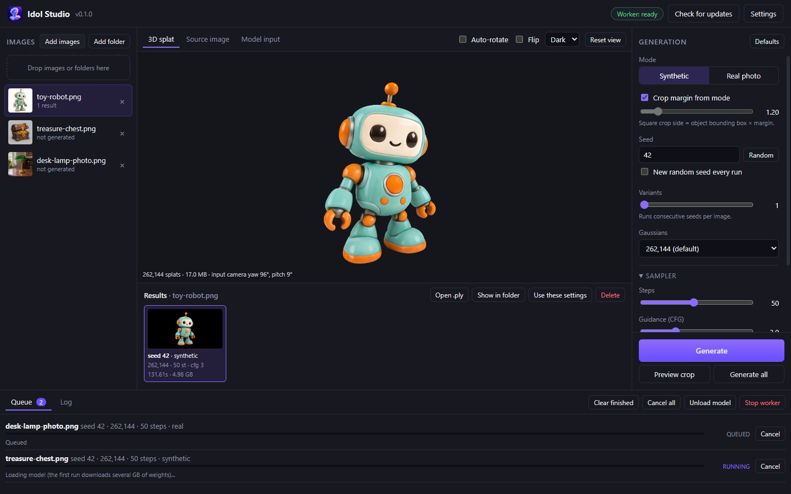
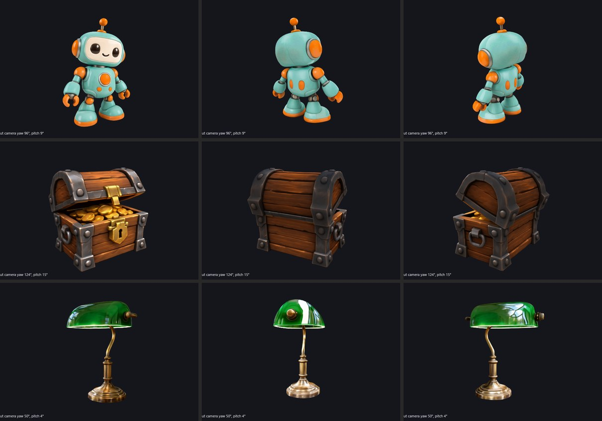

# Idol Studio

A Windows desktop studio for [Idol](https://github.com/speridlabs/idol-sdk), the single-image to 3D Gaussian splat model by Sperid Labs. Add images, tune Idol's options, queue generations and look at the results in a built-in splat viewer.

Built with Rust + Tauri 2. Idol itself runs in a Python worker process that the app starts and keeps loaded on the GPU.



The three test images in `samples/`, generated with the default settings and seen from the front, side and back. Each took about 70 s on an RTX 4060 Ti:



## Features

- **Image library**: add images with the file picker, a whole folder, or by dragging files or folders onto the window. Kept between sessions.
- **All of Idol's options**:
  - mode (`synthetic` for renders and generated images, `real` for photos)
  - crop margin override
  - seed (with a random button and "new random seed every run")
  - number of Gaussians (32,768 to 1,048,576)
  - sampling steps, guidance (CFG) and time shift
  - DINOv3 precision (bf16 or fp32)
  - faster sampling (torch.compile) on or off
  - weights from Hugging Face or a local folder
- **Variants**: generate several consecutive seeds per image in one go.
- **Queue**: generate one image or every image in the list. Shows live sampling progress, and any job can be cancelled.
- **Preview crop**: see the background removal and crop the model will get, before generating. This loads only BiRefNet, so it's quick.
- **3D viewer**: orbit, pan and zoom the splat, with auto-rotate, flip and background options. It opens from Idol's predicted input camera, so you first see the object from the same angle as the source image. The source image and the model input are on their own tabs.
- **Results**: every run is kept per image with its settings, time and VRAM peak. You can open the `.ply`, show it in Explorer, copy its settings back to the panel, or delete it.
- **One-click Python setup**: creates a private environment with CUDA PyTorch, Idol and Triton.
- **Automatic update check**: on start, every 30 minutes while open, and on demand. New versions download and install from GitHub Releases.

## Requirements

- Windows 10/11 with an NVIDIA GPU. Idol peaks at about 7.2 GB of VRAM with the default settings, so a 16 GB RTX 4060 Ti has plenty of room.
- A recent NVIDIA driver (CUDA 12.8 support).
- [uv](https://docs.astral.sh/uv/), recommended. Otherwise you need Python 3.10–3.13 on PATH.
- About 15 GB of disk space: ~5 GB for the Python environment, ~10 GB for the model weights (downloaded on first use).
- A Hugging Face account with access to the two gated encoders Idol uses:
  - [facebook/dinov3-vith16plus-pretrain-lvd1689m](https://huggingface.co/facebook/dinov3-vith16plus-pretrain-lvd1689m): fill in the form. Meta reviews these by hand, so this can take a while.
  - [black-forest-labs/FLUX.2-dev](https://huggingface.co/black-forest-labs/FLUX.2-dev): accept the license. Only its small VAE is used.

## Install

Download the latest release from [Releases](https://github.com/soundtrackgeek/idol/releases):

- `IdolStudio_<version>_x64-setup.exe`: installer (per user, no admin needed)
- `IdolStudio_<version>_x64-portable.exe`: single exe, no install

## First run

1. Open **Settings → Set up / repair environment**. This creates a Python environment in `%LOCALAPPDATA%\com.soundtrackgeek.idolstudio\env` with PyTorch (CUDA 12.8), Idol and `triton-windows`. You can watch the progress in the dialog.
   - If you already have a Python with Idol installed, set **Python interpreter** to that `python.exe` instead.
2. Paste a Hugging Face **access token** into Settings, then press **Check access**. Each gated repo should show ✔.
   - Fine-grained tokens need *"Read access to contents of all public gated repos you can access"*.
   - If the field is empty, the token from `hf auth login` or the `HF_TOKEN` variable is used.
3. Add an image and press **Generate**. The first generation downloads the weights (~10 GB) and compiles the sampler, so it takes a few minutes.

Typical times on an RTX 4060 Ti 16 GB (262,144 Gaussians, 50 steps):

| | |
|---|---|
| loading the model (weights cached) | ~40 s, once per session |
| first image after loading (compiling) | ~85 s |
| each image after that | ~70 s, about 1.4 s per step, 5 GB VRAM peak |

Fewer steps is the quickest way to trade quality for speed. Faster sampling (torch.compile) makes sampling about 1.5× faster once compiled.

Output goes to `Documents\Idol Studio\<image name>\` (you can change this in Settings). Each run writes:

| file | |
|---|---|
| `<name>_<mode>_s<seed>_<N>k_<time>.ply` | the Gaussian splat (standard 3DGS PLY) |
| `..._input.png` | the 1024×1024 image the model saw (background removed, cropped) |
| `..._camera.json` | the predicted input camera (yaw, pitch, radius, fov) |

## Options

| Option | Default | |
|---|---|---|
| Mode | Synthetic | `synthetic`: renders and generated images (crop 1.2). `real`: photos (crop 1.7) |
| Crop margin | from mode | square crop side = object bounding box × margin |
| Seed | 42 | same seed, same object |
| Variants | 1 | runs consecutive seeds per image |
| Gaussians | 262,144 | 32,768 to 1,048,576 |
| Steps | 50 | sampling steps |
| Guidance (CFG) | 3.0 | classifier-free guidance strength |
| Time shift | 3.0 | higher spends more steps at high noise |
| DINOv3 precision | bf16 | fp32 uses 1.7 GB more VRAM |
| Faster sampling | on | torch.compile + batched guidance. The first image after loading the model is slower while it compiles |
| Weights | `speridlabs/idol` | a Hugging Face repo or a local folder |

Changing precision, faster sampling or weights reloads the model on the next run. **Unload model** frees the GPU memory without stopping the worker. **Stop worker** ends the Python process.

## Updates

The app checks [GitHub Releases](https://github.com/soundtrackgeek/idol/releases) a few seconds after start and then every 30 minutes, if **Check for updates** is on in Settings. The **Check for updates** button in the top bar checks right away. When a newer version is out, a banner offers **Download and install**: the app downloads the installer, runs it and closes.

## Development

Requirements: Rust (stable), Node.js 22+, and the WebView2 runtime (part of Windows 11).

```bash
npm install
npm run tauri dev      # run with hot reload
npm run tauri build    # build the installer (src-tauri/target/release/bundle/nsis)
```

Layout:

| path | |
|---|---|
| `src/` | frontend (TypeScript + Vite). `main.ts` holds the UI logic, `viewer.ts` the splat viewer ([Spark](https://sparkjs.dev) + three.js) |
| `src-tauri/src/` | Rust backend: `worker.rs` (Python process), `setup.rs` (environment setup), `updater.rs` (update check), `settings.rs` |
| `src-tauri/python/idol_worker.py` | the Python worker. It is compiled into the app and written to the app data folder at runtime |
| `.github/workflows/release.yml` | builds and publishes a release when the version is bumped |

The worker reads JSON-line requests on stdin (`hello`, `check_access`, `load`, `preprocess`, `generate`, `cancel`, `unload`, `quit`) and answers with JSON-line events on stdout. Library output goes to stderr and shows up in the **Log** tab.

### Releasing

Bump the version in `src-tauri/Cargo.toml` (and `package.json`), add a section to `CHANGELOG.md`, then push to `master`. The Release workflow sees there is no GitHub release for that version yet, builds on Windows, and publishes `v<version>` with the installer and the portable exe attached. It takes its release notes from the changelog.

## Credits

[Idol](https://github.com/speridlabs/idol-sdk) by [Sperid Labs](https://speridlabs.com) (Apache-2.0), which builds on TripoSplat, DINOv3, the FLUX.2 VAE and BiRefNet. Splat rendering by [Spark](https://sparkjs.dev).
